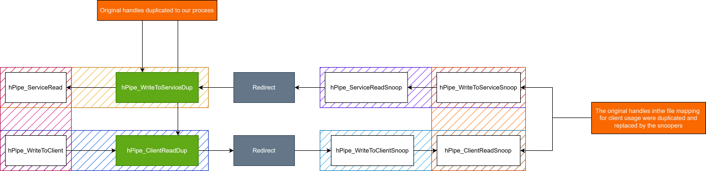

Steam's client and service uses shared memory to establish a connection, and then exchange messages through anonymous pipes. When the service (SteamService.exe) starts, **SteamService.dll** creates a file mapping named **SteamClientService_SharedMemFile** for communication with **steamclient64.dll** (loaded in the steam.exe process). This post looks at how that connection works and how the pipe traffic can be intercepted.

# Starting the connection

To contact the service, **steamclient64.dll** (or its 32-bit counterpart, **steamclient.dll**) [maps a view](https://learn.microsoft.com/en-us/windows/win32/api/memoryapi/nf-memoryapi-mapviewoffile) of the shared memory and writes connection information to it. The mapped structure looks like this:
<pre class="semantic-code"><code class="language-cpp" data-lang="cpp">struct SharedMemFile
{
    DWORD m_bInUse;     
    DWORD m_nLockState;
    DWORD m_dwServicePid;  
    DWORD m_dwClientPid;
    DWORD m_hReadPipe;
    DWORD m_hWritePipe;
    DWORD m_hRequestEvent;
    DWORD m_hReplyEvent;
    DWORD m_bDuplicateRequestEvent;
};
</code></pre>

The client writes an event handle to _m_hRequestEvent_, clears _m_hReadPipe_, and stores its process ID in _m_dwClientPid_. It then sets _m_nLockState_ to 1, or _k_EMasterStateReady_, to signal that it is ready to connect.

<pre class="semantic-code"><code class="language-cpp" data-lang="cpp">enum LockState
{
	k_EMasterStateAvailable = 0,
	k_EMasterStateReady,
	k_EMasterStateWrite,
	k_EMasterStateEnd
};
</code></pre>
> The possible values of _m_nLockState_.

Then, it proceeds to wait for _m_nLockState_ to become _k_EMasterStateWrite_, with a five-second timeout.

<pre class="semantic-code"><code class="language-cpp" data-lang="cpp">int counter = 0;

while (mapView->m_nLockState != k_EMasterStateWrite)
{
	if ( counter >= 5000 )
		break;
       
    counter += 25;
    Sleep(25);
}
</code></pre>

Meanwhile, **SteamService.dll** polls _m_nLockState_:

<pre class="semantic-code"><code class="language-cpp" data-lang="cpp">bool CCrossProcessPipe::PollLockState()
{
	auto mapView = this->mapView;
	if (!mapView)
	    return false;
	    
	switch (mapView->m_nLockState)
	{
		case k_EMasterStateAvailable:
			return false;
		
		case k_EMasterStateReady:
			return ConnectPipe(); // master communication
		
		case k_EMasterStateWrite:
			if (GetElapsedMs() - this->counter &gt; 5000)
				InitializeSharedMemFile();
			return false;
		
		case k_EMasterStateEnd:
			InitializeSharedMemFile();
			return false;
	}
}
</code></pre>

**InitializeSharedMemFile** clears the mapped structure and writes the service's process ID to _m_dwServicePid_. When the client signals that it is ready, the service calls **ConnectPipe**.

I've observed the protocol being used in two momentos so far: when Steam starts and when a game starts.

# Pipes

**ConnectPipe** creates two [anonymous pipes](https://learn.microsoft.com/en-us/windows/win32/ipc/anonymous-pipes). Each pipe carries data in one direction and has a read handle and a write handle. [CreatePipe](https://learn.microsoft.com/en-us/windows/win32/api/namedpipeapi/nf-namedpipeapi-createpipe) returns those handles through its two output parameters.

**CreatePipe** does not take a target process. It returns both handles in the calling process's handle table. Threads in that process can use the handles directly. A child process can also receive inheritable handles if its parent enables handle inheritance when creating it.

This protocol also needs to work when the client and service run in separate processes and when **SteamService.dll** is loaded into the client process. In the latter case, both components share a handle table. Before the [Steam client moved to 64-bit](https://steamcommunity.com/games/593110/announcements/detail/528740542771627405), running it as an administrator could load the 32-bit **SteamService.dll** into the client process. The library discussed here is 32-bit, so that arrangement does not apply to the current 64-bit client.

For bidirectional communication, the service creates two pipes: one for messages to the client and one for messages from it. It then calls [DuplicateHandle](https://learn.microsoft.com/en-us/windows/win32/api/handleapi/nf-handleapi-duplicatehandle) on the write end of the first pipe and the read end of the second. The duplicated handles give the client its two endpoints; the service keeps the opposite endpoints.

## Pipe handles

After the client sets _m_nLockState_ to _k_EMasterStateReady_, the service calls **ConnectPipe** and duplicates the pipe handles needed by the client. It then sets _m_bInUse_ to TRUE and _m_nLockState_ to _k_EMasterStateWrite_. At that point, each side has the handles it needs to send and receive messages.

The diagram shows which handles each process uses and how the file mapping passes them to the client.

> In the diagram, I reversed the displayed read and write outputs of the second call for clarity. The actual **CreatePipe** signature lists the read output first, then the write output.

# Snooping the communication indirectly

The handle exchange provides a way to intercept traffic. By replacing the handles in the mapping before the client reads them, an intermediary can sit between the client and service:

- Create two additional pipes.
- Duplicate the new pipe handles into the **steam.exe** process.
- Duplicate the original pipe handles into the intermediary process.
- Replace the read handle in the file mapping with the read end of one new pipe.
- Replace the write handle in the file mapping with the write end of the other new pipe.

The intermediary can then forward, inspect, or modify messages in either direction.

> It's interesting that you actually don't need to do all of the above to communicate, as you can simply start the communication with the service, since it doesn't check what process is starting it. But if you consider the possibility that Steam adds an integrity check related to the PID for example, this bypasses it. Also, it was a pretty interesting exercise to think what could be done if we don't use direct communication!

---

# The message format

An intermediary that can read and write the pipes can also craft messages of its own. This part describes the format both sides use, and the interfaces that turn out to be interesting.

Every message on a pipe has the same shape: a four-byte little-endian length followed by that many payload bytes. If you inspect the binaries, you'll see that the functions used for reading/writing to the pipe comes in pairs, one for reading the length and another for reading the payload. The payload starts with a one-byte command:

- **0x01**: an interface call,
- **0x06**: the service answers a `06` with `06`.
- **0x09**: a connection handshake. The client sends a fixed value, its process ID, and its thread ID. The service replies with its own.

An interface call continues with an interface byte, a four-byte user field, a four-byte method ID, the method's arguments, and a final four-byte "fencepost", a checksum-like value the handler recomputes from the request. The shortest possible call is the one this post ends up using:

<pre class="semantic-code"><code class="language-cpp" data-lang="cpp">01                       // outer command: interface call
06                       // interface: IClientWindowsHWMonitor
00 00 00 00              // user field
C1 FD 6A 67              // method: StartMonitoring
B4 48 A8 67              // fencepost
</code></pre>

The service knows six interfaces:

- **IClientInstallUtils**: installation helpers: firewall entries, protocol handler registration, install scripts. (the one KillaBoi used in his exploit)
- **IClientModuleManager**: loading and executing code modules inside the service.
- **IRegistryInterface**: registry reads and writes, gated by an allowlist.
- **IClientProcessMonitor**: process registration and control.
- **IClientSecureDesktop**: secure desktop streaming and the secure-attention-sequence call.
- **IClientWindowsHWMonitor**: hardware monitoring through a CPUID SDK.

The reply carries the outer `01` again, followed by a method-specific result. An unknown method ID produces error code 12. The fencepost deserves a note: a mismatch does not reject the request. The service logs an assertion, which only breaks into a debugger when one is attached, and calls the method anyway.

Three of those interfaces are worth a closer look.

# IClientModuleManager

Interface `0x02` moves executable modules into the service. This interface existed for anti-cheat purposes: Valve Anti-Cheat (VAC) modules were delivered to the service and executed there, with the service's SYSTEM rights. **LoadModule** (a function present in SteamService.dll) stores one, the request carries the CRC32 of the module bytes, which becomes the module's identifier, a declared length, and the bytes themselves.

A "module" is basically the long-deactivated VAC module: a PE image with a Valve-specific header sitting between the DOS header and the PE signature, the marker `VLV\0` at file offset `0x40`, a format version, a four-byte signed length, and a 128-byte RSA signature. On the first execution the service verifies the module: a CRC32 over the declared buffer, and an RSA PKCS#1 v1.5 signature over a SHA-1 digest of the image prefix in a normalized form, with the signature and checksum fields zeroed for the computation, checked against a public key compiled into the service. Only then does it resolve the module's single export, _\_runfunc@20_, and call it with the operation number, the input pointer and length, and an output buffer.

> The IPC channel described earlier was previously used to stream the modules to the service. Fun little detail is that changing a specific boolean in a module header would cause the service to ignore that module and skip loading it, basically not calling the so known _\_runfunc@20_. Valve later stopped streaming the modules completely (probably around october/november 2025).

Submitting a module of our own did not get far. The RSA signature is the wall, so without Valve's private key there is no way to produce a module the service will execute. The service accepted and stored our unsigned module, but execution preparation stops at the signature check, and _\_runfunc@20_ never ran.

# IClientProcessMonitor

Interface `0x04` is a small process-control surface. **RegisterProcess** and **UnregisterProcess** maintain a reference-counted table of monitored processes. **TerminateProcess**, **SuspendProcess**, and **ResumeProcess** act on any process ID supplied in the packet.

The requests carry a PID, and for termination an exit code, but nothing ties that PID to the caller. The handlers perform no ownership or identity check and never consult the registered-process table: **TerminateProcess** opens the supplied PID with `PROCESS_TERMINATE` and calls [TerminateProcess](https://learn.microsoft.com/en-us/windows/win32/api/processthreadsapi/nf-processthreadsapi-terminateprocess); suspend and resume are [DebugActiveProcess](https://learn.microsoft.com/en-us/windows/win32/api/debugapi/nf-debugapi-debugactiveprocess) and **DebugActiveProcessStop**, a debug-port attach and detach. The service runs as SYSTEM, so these calls execute with the rights of that token, which is pretty interesting.

# IClientWindowsHWMonitor

## The interface

Interface `0x06` looks harmless: **StartMonitoring**, **StopMonitoring**, **RefreshInformation**, and **GetCPUTemperature**, all without arguments, each a 14-byte frame. **StartMonitoring** increments a reference count and, on the first registration, spawns a thread named _InitCPUIDSDKThread_. Everything interesting happens on that thread.

The thread loads **cpuidsdk.dll** by a relative name. The DLL ships beside the service in an administrator-owned directory and carries a valid signature, so the usual search-order tricks do not apply. The library exports a single function, **QueryInterface**, which works as a keyed function resolver: the service calls it with a series of magic numbers to obtain the rest of the SDK's API, and finally issues the SDK's driver-install command. No path, name, or argument is supplied. The SDK decides everything internally.

## The driver the SDK installs

[CPU-Z](https://www.cpuid.com/softwares/cpu-z.html) is a widely used hardware information utility from CPUID, and its driver is the kernel component that reads clocks, voltages, temperatures, and other hardware details. That driver is what the SDK installs.

The SDK embeds the CPU-Z hardware-monitoring driver family as resources, one image per supported architecture, and selects the x64 build on a 64-bit host. Installation runs with _SeLoadDriverPrivilege_ on the SYSTEM token, the driver is extracted to disk, registered as a kernel service through [CreateServiceW](https://learn.microsoft.com/en-us/windows/win32/api/winsvc/nf-winsvc-createservicew), and started through [StartServiceW](https://learn.microsoft.com/en-us/windows/win32/api/winsvc/nf-winsvc-startservicew).

Two details matter. The base directory is `C:\ProgramData\CPUID Software\sdk`, created on demand, and its permissions allow a standard user to create files there; a temp-directory fallback exists for the case where the directory cannot be created, and live runs showed both locations in use. And the file name is not fixed: it is random, regenerated on every install command.

## The name generator

The name comes from the millisecond clock. The SDK seeds the C runtime generator with [srand](https://learn.microsoft.com/en-us/cpp/c-runtime-library/reference/srand) and the value of [timeGetTime](https://learn.microsoft.com/en-us/windows/win32/api/timeapi/nf-timeapi-timegettime), milliseconds since boot. It draws a length between 8 and 15 from the first call, and then draws one value per character, mapping each onto a 62-character alphanumeric alphabet. This is basically a linear-congruential generator, so it is entirely predictable once the seed is known.

The constants were recovered from the module and transcribed. To validate the transcription, the file name observed in a live run was searched backwards: brute-forcing the seed space around the trigger time produced exactly one seed that generates the observed name, 16 milliseconds after the trigger packet was sent. The transcription is exact, and the gap between the packet and the generator call is measured in tens of milliseconds.

Reproducing the generator takes only a few lines. The seed advances as `seed = seed * 214013 + 2531011`, the classic MSVC constants, and `rand()` returns the middle bits of that state:

<pre class="semantic-code"><code class="language-cpp" data-lang="cpp">void GenerateDriverName(char* name, int nameSize)
{
    srand(timeGetTime());                          // milliseconds since boot

    static const char alphabet[] =
        "0123456789ABCDEFGHIJKLMNOPQRSTUVWXYZabcdefghijklmnopqrstuvwxyz";

    int length = 8 + (int)((double)rand() * 7.0 / 32767.0);  // 8..15 characters
    if (length &gt; nameSize)
        length = nameSize;

    for (int i = 0; i &lt; length; ++i)
        name[i] = alphabet[rand() % 62];
    name[length] = '\0';
}
</code></pre>

One detail is worth pointing out: the length mapping runs through a floating-point expression rather than a modulo operation, a small fingerprint that made the transcription unambiguous.
## Filling the window

Before writing anything, the extractor checks whether the target file already exists with a plain [CreateFileA](https://learn.microsoft.com/en-us/windows/win32/api/fileapi/nf-fileapi-createfilea) using `OPEN_EXISTING`. If the file opens, extraction is skipped, and the pre-existing file is never read, hashed, or verified. The only integrity check in the pipeline, a byte-sum over the resource, applies to what the SDK would write, not to what is already on disk. Whoever creates the file first decides what the service loads.

The existence check itself is as plain as it looks:

<pre class="semantic-code"><code class="language-cpp" data-lang="cpp">HANDLE file = CreateFileA(fileName, GENERIC_READ, 0, nullptr,
                      OPEN_EXISTING, FILE_ATTRIBUTE_NORMAL, nullptr);
if (file != INVALID_HANDLE_VALUE)
{
    CloseHandle(file);
    return 0;        // the file is already there, extraction is skipped
}
</code></pre>

Only after this point does the extractor touch the embedded resource, run its byte-sum check, and open the file for writing.

The random name turns this into a coverage problem. The seed is a millisecond tick, so for a trigger sent at a known moment, the name the SDK will generate is one of a small set: one candidate per millisecond inside the window where the generator call can land. The approach is to pre-create that set, one copy of a legitimately signed driver per millisecond so the kernel's own signature check passes, in the base directories, and then send the trigger with the window placed ahead of it. The send fires at the window's start edge, the SDK's generator call lands tens of milliseconds inside, and the freshly generated name collides with an existing file.

The window has two sizes to pick: how far ahead of the trigger it starts, which gives the plant time to be written, and how many milliseconds it covers, which absorbs the scheduling delay between the packet and the generator call. With the measured latency, a window of a few hundred milliseconds carries a large margin.

## Marking the files

The SDK does inspect its candidates, just not for identity. Before extraction it opens the existing path read-write, exclusively, and byte-sums its content. A byte-identical copy of the expected driver counts as stale: the SDK deletes it and writes a fresh copy, which is the overwrite itself. Any other content produces a different sum: the SDK leaves its exclusive handle open, its own write and delete attempts on that path fail behind it, and the extraction falls back to a temp directory. The fallback does not matter: the service registration is built from the primary directory path and the generated name, which is our file.

The cleanup does not matter either. Each candidate created by an attacker is marked after creation with [SetFileSecurity](https://learn.microsoft.com/en-us/windows/win32/api/securitybaseapi/nf-securitybaseapi-setfilesecurityw) using this descriptor:

<pre class="semantic-code"><code class="language-cpp" data-lang="cpp">D:(D;;DC;;;WD)(D;;SD;;;WD)(A;;FA;;;WD)
</code></pre>

`D` is the DACL. The first two entries deny `DELETE_CHILD` and `DELETE` to Everyone; the third allows full access. A delete request on the file is therefore refused, including the SDK's failure-cleanup path, which otherwise removes the service and its driver when startup fails.

## The outcome

With a candidate in place for the generated name, the sequence ends with the service registration pointing at our file and [StartServiceW](https://learn.microsoft.com/en-us/windows/win32/api/winsvc/nf-winsvc-startservicew): we end up with a driver loaded, started by the service as a consequence of the message that arrived over the pipe. Kernel-mode code signing is the only integrity gate on the planted content, and the cpuidsdk interface pass it legitimately.

Also, service registration is persistent, so creating a service under an existing name returns success to the SDK, which keeps loading the first-registered image path on every later start. Registrations left behind by earlier SDK versions on the test machine showed exactly this across version bumps.

Basically, a channel designed for internal communication can be intercepted at the handle exchange; the service exposes process control and module execution to whoever can read the protocol; and the hardware-monitoring interface makes the service install and start a kernel-mode driver whose name is predictable and whose location is writable by any local user. The driver that ends up loading is whichever validly signed file got there first.

There's just one problem in that: if the interface was previously used before, we can't delete the original driver without admin privileges, so this only works if the user has never used the interface before. The limitation, however, is per version. Each SDK build embeds its own driver generation, and the service name follows it, so a future SDK update that ships a newer driver would pick a fresh service name and reopen the window without any cleanup. On a machine where the user has administrator rights, the same reset is one service deletion away.
